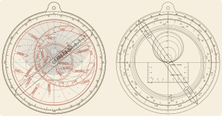

# Astrolabes

[](https://mthelm85.github.io/Astrolabes.jl/stable)
[](https://mthelm85.github.io/Astrolabes.jl/dev)
[](https://github.com/mthelm85/Astrolabes.jl/actions/workflows/Test.yml?query=branch%3Amain)
[](https://codecov.io/gh/mthelm85/Astrolabes.jl)
[](https://github.com/mthelm85/Astrolabes.jl/actions/workflows/Lint.yml?query=branch%3Amain)
[](https://github.com/mthelm85/Astrolabes.jl/actions/workflows/Docs.yml?query=branch%3Amain)
[](https://github.com/JuliaBesties/BestieTemplate.jl)


Geometrically exact, fabrication-ready planispheric astrolabes for any latitude and
epoch. Every line is verified against spherical astronomy, the finished instrument is
operated in simulation against closed-form answers, and the parts are checked against
the rules of the shop that will make them.

<p align="center"></p>

```julia
using Astrolabes

a = astrolabe(47.3; longitude = 8.54, timezone = 1.0)   # Zürich, 150 mm, laser cut
verify(a)                  # ≈ 200 checks: geometry, the instrument in use, fabrication
render(a, "zurich")        # SVG + DXF for every part, and parts.txt
```

Upload the files to a laser-cutting, sheet-metal or PCB service:

| profile | output |
|---|---|
| `LaserCut()` | SVG and DXF per part, layers `CUT` / `ENGRAVE` / `SCORE` |
| `Metal()` | cut and engrave layers in separate DXF/SVG files; 1 mm features, holes ≥ sheet thickness |
| `PCB()` | DXF per KiCad layer (`Edge_Cuts`, `F_Cu`, `F_SilkS`) |
| `Paper()` | 1:1 SVG proof with a calibration bar, to check fit before ordering |

## What's on it

- **Plates** for any latitude, either hemisphere: horizon, almucantars, azimuths,
  twilight, exact unequal hours.
- **Rete** with the graduated ecliptic and bright stars from the Hipparcos new
  reduction, precessed to the epoch (SOFA long-term precession), with IAU or traditional
  names.
- **Limb** hour and degree scales, optionally set for your longitude and time zone.
- **Back**: altitude scale, zodiac, calendar (concentric or medieval eccentric), equation
  of time, shadow square, unequal hours, optional sine quadrant.
- **Rule, alidade and sight vanes.**

Historical instruments work too: `astrolabe(51.75; epoch = 1391.0, calendar = :eccentric,
names = :traditional)` uses the Julian calendar, 1391 star positions and obliquity.

## Using it

```julia
sim = simulate(a)
sunrise(sim, (6, 21))                 # read off the drawn instrument
star_transit(sim, "Sirius", (1, 1))
error_budget(a)                       # effect of fabrication tolerances, minutes
```

See the [documentation](https://mthelm85.github.io/Astrolabes.jl/dev) for how it works,
fabrication guides and the verification method.

## Data

Star positions: Hipparcos, the New Reduction (van Leeuwen 2007, VizieR I/311) and the
Hipparcos catalogue (ESA 1997, VizieR I/239), via the VizieR service of CDS, Strasbourg.
See [`data/README.md`](data/README.md).
