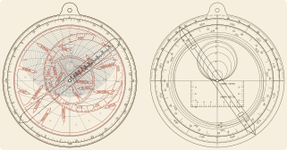
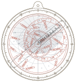
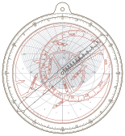
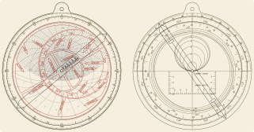
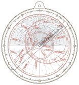
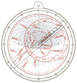
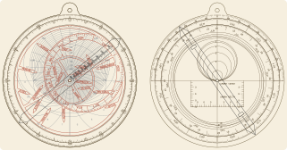

# [Gallery](@id gallery)

Each instrument below passed `verify` (geometry, use and fabrication checks) before its
preview was drawn. Rebuild them with `julia --project=. examples/gallery.jl`.

## Zürich (47.3°N), hour scale in CET

```julia
astrolabe(47.3; longitude = 8.54, timezone = 1.0)
```



## London (51.5°N), brass

```julia
astrolabe(51.5; profile = Metal())
```



## Oxford 1391 (51.75°N), after Chaucer's *Treatise on the Astrolabe*

```julia
astrolabe(51.75; epoch = 1391.0, calendar = :eccentric, names = :traditional)
```



## Sydney (33.9°S)

```julia
astrolabe(-33.9)
```



## The equator, the tropic and the Arctic Circle

```julia
astrolabe(0.0); astrolabe(23.4); astrolabe(66.0)
```




