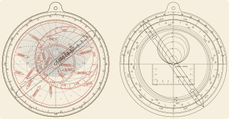

```@meta
CurrentModule = Astrolabes
```

# Astrolabes.jl

Geometrically exact, fabrication-ready planispheric astrolabes for any latitude and
epoch. Every drawn line is checked against spherical astronomy, the finished instrument is
operated in simulation and compared with closed-form answers, and the parts are checked
against the rules of the shop that will make them.



## Quick start

```julia
using Astrolabes

a = astrolabe(47.3; longitude = 8.54, timezone = 1.0)   # Zürich, 150 mm, laser cut
verify(a)                     # ≈ 200 checks: geometry, use, fabrication
render(a, "zurich")           # SVG + DXF for every part, and parts.txt
```

`render` writes one file set per part: the mater (with the back engraved), the limb ring,
the plate(s), the rete, the rule, the alidade and its two sight vanes. Upload them to a
laser-cutting, metal-cutting or PCB service; `parts.txt` lists quantities, sizes and the
assembly order.

## What you get

- **Plates** for any latitude from the equator to the pole, either hemisphere: equator,
  tropics, horizon, almucantars, twilight lines, azimuths and exact unequal hours.
- **Rete** with the ecliptic graduated to the degree and up to ~35 bright stars from the
  Hipparcos new reduction, precessed to your epoch, with IAU or traditional names.
- **Mater** with 24- or 12-hour and degree scales, optionally set for your longitude and
  time zone; on the **back** the altitude scale, zodiac and calendar (concentric or the
  medieval eccentric form), equation of time, shadow square, unequal hours and an
  optional sine quadrant.
- **Profiles** for laser-cut sheet ([`LaserCut`](@ref)), metal ([`Metal`](@ref)),
  printed-circuit boards ([`PCB`](@ref)) and a 1:1 paper proof ([`Paper`](@ref)).

## Pages

- [How it works](@ref how) — the projection and what each line means.
- [Using the library](@ref using) — options, multiple plates, historical epochs.
- [Fabrication](@ref fabrication) — profiles, file formats, ordering and assembly.
- [Verification](@ref verification) — what is checked and how.
- [Gallery](@ref gallery).

## Conventions

- Degrees at the public API; radians internally.
- Geometry uses equator radius `R = 1`; millimetres only in `render`. `a.scale` is
  millimetres per unit.
- Northern instruments project from the south celestial pole: east is on the left and the
  rete turns clockwise. Southern instruments project from the north pole and are drawn as
  the mirror image, as the southern sky looks to an observer facing the pole: east is on
  the right and the rete turns anticlockwise. The instrument for −φ is the mirror image of
  the one for +φ.
